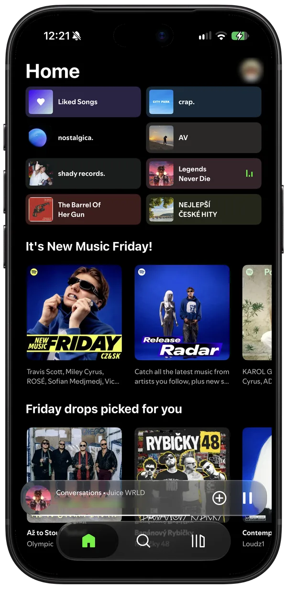
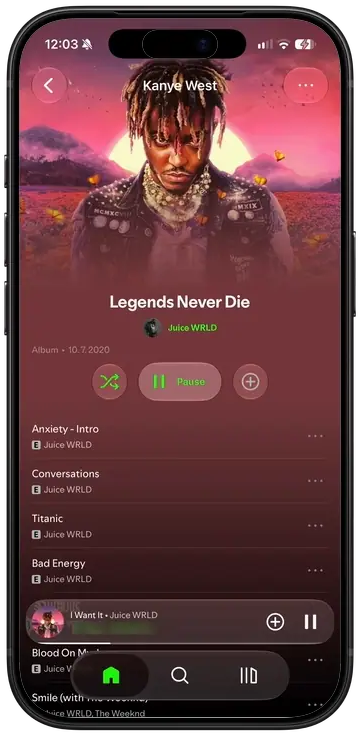
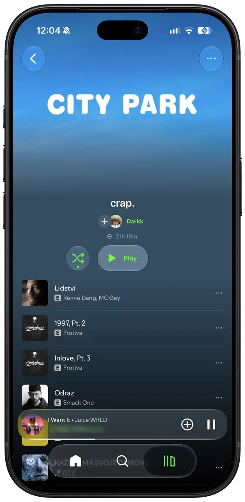
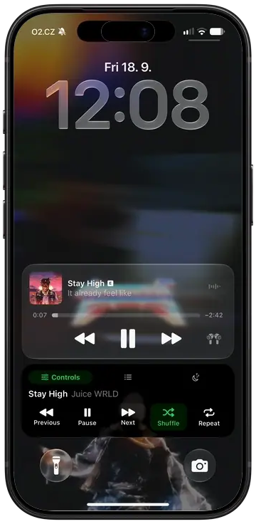

<h1 align="center">SPMod</h1>

A Liquid Glass redesign of Spotify for iOS, with themes, lyrics and a lot of switches.

  
  
  
  

  <a href="#features">Features</a> ·
  <a href="#build-it">Build it</a> ·
  <a href="#install-it">Install it</a> ·
  <a href="docs/tweaks.md">Hack on it</a>

  
  
  
  

## What it is

SPMod is a Theos tweak (Objective-C and Logos) injected into your own decrypted Spotify IPA and signed
with your own certificate. No jailbreak is needed.

It is built and tested on **Spotify 9.1.90**. The mod hooks Spotify's own classes, which change between
releases, so another version may build and then break.

| | |
|---|---|
| Redesigned look (Liquid Glass) | **iOS 26+** |
| Native look | iOS 16.1+ |
| Live Activity | iOS 17+ |

## Two looks

Mod Settings → Appearance → **Redesigned UI** picks one of two looks. The choice is read at launch, so
changing it needs a restart.

- **Redesigned**: the mod's own Liquid Glass interface. Glass tab bar, search field and now playing bar,
  a redesigned player and lyrics page, a decluttered Home, and playlist, album and artist pages laid out
  the way the Music app does. Black throughout, with its own accent colour.
- **Native**: Spotify's own screens with the mod's tweaks on top (hide switches, glass header buttons,
  Home gradient, AMOLED, accent colour).

The redesign is drawn with the system's glass, which only exists from iOS 26. Below that the switch
shows "Needs iOS 26" and the mod runs the native look.

## Features

Everything below works under both looks.

- **Themes**: accent colour (fixed or automatic from the artwork), AMOLED black, named theme presets
  you can save and re-apply, an animated settings background, and a scheduled night mode that dims the
  app during the hours you choose.
- **Lyrics**: several lyric sources, Apple Music style lyrics, and lyrics on the lock screen.
- **Player**: gestures, speed and pitch, a sleep timer, animated artwork and a Live Activity.
- **Listening**: ad blocking, blocked artists, privacy switches and Spotify's feature flags.
- **Downloads**: control of Spotify's offline downloads, plus lossless downloads.
- **Backup**: export and import every setting, so a reinstall does not lose them.
- **Developer**: copy the view tree of the screen in front, copy diagnostics and read the device log.

All of it lives in Settings → **Mod Settings**, which has its own search field.

## Build it

Bring a decrypted **Spotify 9.1.90** IPA. You get an unsigned `SPMod.ipa` to sign with SideStore,
Feather or any certificate signer.

### With GitHub Actions (recommended)

Fork the repo, enable Actions and run **Build SPMod IPA**. It takes a direct link to your decrypted
`.ipa` and hands the built IPA back as a workflow artifact, a filebin link, or both. No Mac is needed,
and the link is masked in the log.

### On a Mac

You need Theos in `~/theos` and Xcode with an iPhoneOS 26+ SDK selected with `xcode-select`. An SDK in
`~/theos/sdks` alone builds too, but without the Live Activity.

    brew install make ldid dpkg zsign ideviceinstaller libimobiledevice
    uv tool install "cyan @ git+https://github.com/asdfzxcvbn/pyzule-rw"

Put the decrypted `.ipa` in `ipa/`, then:

    make release    # out/SPMod.ipa, ready to sign
    make install    # the same, signed with your certificate and pushed over USB

`make install` reads `SIGN_P12`, `SIGN_PROFILE` and `SIGN_P12_PASSWORD` from `.signing.env`. Copy
`.signing.env.example` and fill it in.

The first build spends a minute reading Spotify's flags out of your IPA. `make flags` regenerates them.

## Install it

Install the built `SPMod.ipa` with any sideloader, such as SideStore, Feather, AltStore or Sideloadly.

Sign with a bundle id matching your certificate's App ID. If it does not match, the app still works,
but tapping the player on the lock screen will not open it, and the app tells you on first launch which
id to use. In Feather, copy the App ID into **Identifier** and leave **PPQ protection** off. AltStore,
SideStore and Sideloadly get this right on their own.

The app keeps Spotify's bundle id, so it installs over the real Spotify.

## Safari link opener

IPA builds include the Open in Spotify Safari extension. See
[setup, coverage and verification](docs/safari-extension.md). Run `make test-safari` for the regression
checks, and build with `SAFARI=0` to leave it out.

## Hack on it

[docs/tweaks.md](docs/tweaks.md) is the full guide: the layers under `tweak/Sources/`, the rules between
the two looks, and the known traps. `make log` streams the tweak's log lines from the phone, and
`make session` records clean view trees to prove a class or selector before hooking it.

## Credits

SPMod is by [RK28A](https://github.com/RK28A). It is built on an MIT-licensed Objective-C base; the
original copyright notice is kept in [LICENSE](LICENSE) and [NOTICE.md](NOTICE.md).

[cyan](https://github.com/asdfzxcvbn/pyzule-rw) injects, [Theos](https://theos.dev) builds, and
[FLEX](https://github.com/FLEXTool/FLEX), as hopeless's AutoFLEX build in `vendor/`, is the inspector
the view trees are read through. The downloads engine is
[Pixie](https://github.com/Glongq/Vitrine-Pixie), by Glongq.

Code originating from chroma.pw and licensed under GPL-3.0 retains its own licensing terms; the MIT
license applies only to code whose rights holders authorize it.

Not affiliated with Spotify.
